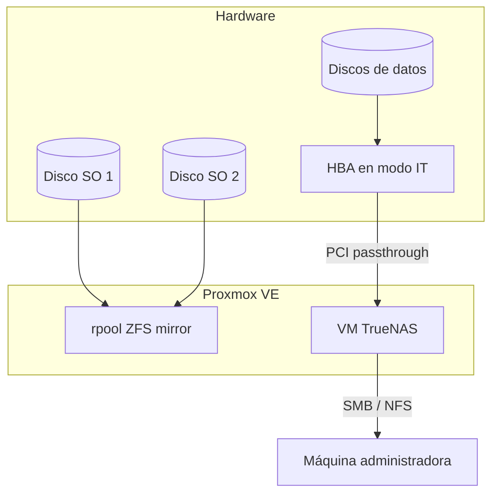

 #title: Almacenamiento en Proxmox - ZFS RAID 1 y TrueNAS aliases: [Guía Proxmox ZFS, Guía TrueNAS VM, Homelab Storage] tags: [homelab, proxmox, zfs, truenas, almacenamiento, smb, guia] nivel: intermedio tiempo-estimado: 2-3 h estado: revisado

# Almacenamiento en Proxmox: ZFS RAID 1 y TrueNAS

> [!abstract] Qué vas a lograr Al terminar esta guía tendrás:
> 
> 1. Un nodo Proxmox VE instalado sobre **ZFS en espejo (RAID 1)**.
> 2. Una **VM de TrueNAS** que administra tus discos de datos.
> 3. Una **carpeta compartida SMB** (`homelab-logs`) montada de forma segura en tu máquina de administración.

**Requisitos previos:** conocimientos básicos de Linux y red (IP, DNS, gateway), acceso al BIOS/UEFI del equipo y 2 discos idénticos para el sistema, más discos adicionales para datos.

## 0. Visión general de la arquitectura



|Capa|Función|Quién gestiona los discos|
|---|---|---|
|`rpool` (mirror)|Sistema operativo de Proxmox, VMs y contenedores|Proxmox (ZFS)|
|Pool de datos|Archivos, backups, logs, media|TrueNAS (ZFS)|

> [!warning] Regla de oro **Cada pool ZFS debe ser gestionado por un solo sistema.** Si usas passthrough, el pool de datos pertenece a TrueNAS: **nunca lo importes en el host Proxmox** (riesgo de corrupción).

---

## 1. Proxmox VE sobre ZFS RAID 1 (espejo)

Con dos discos idénticos para el sistema, ZFS en espejo es una excelente opción.

### 1.1 Qué te da (y qué no)

- **Integridad de datos:** ZFS usa checksums en todos los bloques. Con espejo, si detecta un bloque corrupto lo **repara automáticamente** con la copia sana (_self-healing_).
- **Redundancia:** si un disco falla, el sistema **sigue funcionando** con el disco restante (modo `DEGRADED`) hasta que lo reemplaces.
- **Snapshots casi instantáneos:** gracias a _copy-on-write_, crear un snapshot es prácticamente inmediato y consume espacio solo a medida que los datos cambian.

> [!danger] RAID no es backup El espejo protege contra **la falla de un disco**, no contra borrado accidental, ransomware, errores humanos, robo o incendio. Necesitas además **backups** (regla 3-2-1: 3 copias, 2 medios distintos, 1 fuera del sitio). Ver [[#7. Mantenimiento y buenas prácticas]].

> [!note] Terminología Un espejo da **redundancia**, no "alta disponibilidad" en sentido estricto (que implica varios nodos y failover automático). Con un solo servidor, si el equipo entero cae, el servicio cae.

### 1.2 Recomendaciones de hardware

- Usa **discos idénticos o de capacidad similar** (se aprovecha la capacidad del menor).
- **No uses RAID por hardware** con ZFS: ZFS necesita ver los discos directamente (modo AHCI/JBOD/HBA).
- Evita discos **HDD con tecnología SMR** para ZFS (rendimiento pobre en resilvering).
- Para SSD, prefiere modelos con **protección contra pérdida de energía (PLP)** y buena resistencia (TBW); los SSD de consumo se desgastan rápido con ZFS + VMs.
- Si es posible, conecta una **UPS** para evitar cortes bruscos.

### 1.3 Instalación

1. Descarga la ISO desde [proxmox.com](https://www.proxmox.com/en/downloads) y crea un USB booteable.
2. Arranca el instalador. En **Target Harddisk → Options** elige:
    - **Filesystem:** `zfs (RAID1)`
    - Selecciona **ambos discos** (deja el resto en `-- do not use --`).
    - Deja los valores por defecto de `ashift` (12) y compresión salvo que sepas por qué cambiarlos.
3. Completa país, contraseña de `root`, correo y red (**IP estática** recomendada).

### 1.4 Verificación post-instalación

```bash
# Estado del pool: debe mostrar ONLINE y mirror-0 con ambos discos
zpool status rpool

# Espacio y salud
zpool list
```

### 1.5 Limitar la memoria del ARC en el host (recomendado)

Por defecto ZFS puede usar hasta ~50 % de la RAM como caché (ARC). En un host que también ejecuta VMs conviene fijar un tope (ejemplo: 4 GiB):

```bash
echo "options zfs zfs_arc_max=$((4 * 1024 * 1024 * 1024))" > /etc/modprobe.d/zfs.conf
update-initramfs -u -k all
reboot
```

### 1.6 Reemplazo de un disco fallado

> [!warning] Importante En Proxmox el disco de arranque no solo contiene ZFS: también tiene **partición de arranque (ESP)**. Debes recrearla en el disco nuevo o el sistema podría no arrancar si falla el otro disco. Consulta siempre la [documentación oficial de Proxmox](https://pve.proxmox.com/wiki/ZFS_on_Linux#_zfs_administration) para tu versión.

Resumen del procedimiento (sustituye los nombres por los de tu equipo; usa `ls -l /dev/disk/by-id/` para identificarlos):

```bash
# 1. Ver qué disco está fallado
zpool status rpool

# 2. Copiar la tabla de particiones del disco SANO al NUEVO y randomizar GUIDs
sgdisk <DISCO_SANO> -R <DISCO_NUEVO>
sgdisk -G <DISCO_NUEVO>

# 3. Reemplazar en el pool (usa la partición ZFS, normalmente la 3)
zpool replace -f rpool <PARTICION_ZFS_VIEJA> <PARTICION_ZFS_NUEVA>

# 4. Reconfigurar arranque en el disco nuevo (partición ESP, normalmente la 2)
proxmox-boot-tool format <PARTICION_ESP_NUEVA>
proxmox-boot-tool init <PARTICION_ESP_NUEVA>

# 5. Monitorear el resilver hasta que termine
zpool status rpool
```

---

## 2. TrueNAS como máquina virtual

### 2.1 ¿Qué edición elegir?

- **TrueNAS SCALE** (basado en Debian; las versiones recientes se publican como _TrueNAS Community Edition_) es la opción recomendada para instalaciones nuevas.
- **TrueNAS CORE** (basado en FreeBSD) está en modo de mantenimiento y no recibe nuevas funciones. Evítalo en proyectos nuevos.

> [!note] Los nombres de menús varían entre versiones. Esta guía usa los de SCALE / Community Edition; verifica los de tu versión.

### 2.2 Recursos de la VM

|Recurso|Mínimo|Recomendado|
|---|---|---|
|CPU|2 núcleos|2-4 núcleos, tipo `host`|
|RAM|8 GB|16 GB o más (ZFS usa RAM como caché ARC)|
|Disco de arranque|16 GB (virtual, en `rpool`)|32 GB|
|Red|VirtIO sobre `vmbr0`|VirtIO, IP fija o reserva DHCP|

Configuración sugerida en Proxmox:

- **Machine:** `q35` y **BIOS:** `OVMF (UEFI)` (necesario para passthrough PCIe).
- **Memoria:** desactiva el **Ballooning** (TrueNAS necesita su RAM fija).
- **Disco virtual:** solo para el SO de TrueNAS. Los discos de datos **no** deben ser discos virtuales.
- **Opciones → Start at boot:** activado, con **Start/Shutdown order** bajo (por ejemplo `1`) y un _startup delay_ para que otras VMs que dependan del NAS arranquen después.

### 2.3 Passthrough de la controladora HBA (muy recomendado)

TrueNAS debe ver los discos **directamente** para leer su SMART, controlar errores y gestionar ZFS sin capas intermedias. Para eso se pasa una controladora **HBA en modo IT** (por ejemplo, una LSI 9207/9300 flasheada) a la VM.

**Pasos resumidos:**

1. En el BIOS/UEFI activa **VT-d** (Intel) o **AMD-Vi/IOMMU** (AMD).
2. Activa IOMMU en el kernel de Proxmox:
    - Intel: añade `intel_iommu=on iommu=pt` a `GRUB_CMDLINE_LINUX_DEFAULT` en `/etc/default/grub` (o en `/etc/kernel/cmdline` si Proxmox arranca con `systemd-boot`, que es habitual con ZFS en UEFI).
    - AMD: IOMMU suele venir activo; `iommu=pt` es opcional.
    - Aplica con `update-grub` o `proxmox-boot-tool refresh` y reinicia.
3. Verifica los grupos IOMMU:
    
    ```bash
    dmesg | grep -e DMAR -e IOMMU
    lspci -nn | grep -i -e sas -e sata -e lsi
    ```
    
4. En la VM: **Hardware → Add → PCI Device** → selecciona la HBA → marca **All Functions** y **PCI-Express**.

> [!danger] No pases la controladora de arranque de Proxmox Si los discos del `rpool` cuelgan de la misma controladora SATA que vas a pasar a la VM, **el host perderá su sistema**. La HBA para TrueNAS debe ser **independiente** de los discos de Proxmox.

> [!tip] Sin HBA dedicada Si no tienes HBA, puedes pasar discos individuales por `by-id` (`qm set <VMID> -scsi1 /dev/disk/by-id/...`), pero TrueNAS no tendrá acceso real a SMART y es una opción **menos segura**. Solo úsala en laboratorio, no con datos importantes.

### 2.4 Red

- Conecta la VM a un bridge (por ejemplo `vmbr0`) con modelo **VirtIO**.
- Asigna **IP fija** (o reserva DHCP en tu router). Si tienes un switch gestionable, considera una **VLAN** de almacenamiento.
- En homelabs con tráfico alto, usa una NIC o bridge separado para el tráfico NAS.

### 2.5 Instalación y creación del pool

1. Arranca la VM con la ISO de TrueNAS e instálalo en el disco virtual de arranque.
2. Crea un usuario administrador y **deshabilita el uso de `root` para el acceso diario**.
3. En la interfaz web: **Storage → Create Pool** y elige la topología según tus discos:

|Discos|Topología|Tolerancia|
|---|---|---|
|2|Mirror|1 disco|
|3-4|RAIDZ1 (4+ discos: valora RAIDZ2)|1 disco|
|4+|RAIDZ2|2 discos|

---

## 3. Carpeta compartida para logs y administración

> [!warning] Dependencia circular Si guardas los logs de Proxmox **dentro de una VM de Proxmox**, cuando el host falle perderás justo los registros que necesitas para diagnosticarlo. Para logs críticos, usa un **segundo equipo/servidor syslog** o una copia periódica fuera del host. Esta carpeta sirve para **lectura y diagnóstico centralizado**, no como única fuente de verdad.

### Paso 1: Crear el dataset

1. Ve a **Datasets** → selecciona tu pool → **Add Dataset**.
2. Nombre: `homelab-logs`.
3. **Dataset Preset:** `SMB`.
4. Guarda y opcionalmente configura una **cuota** para que los logs no llenen el pool.

### Paso 2: Crear usuario y grupo

1. **Credentials → Local Groups → Add:** `logs-admins`.
2. **Credentials → Local Users → Add:** `logs-reader` (sin shell, solo SMB), y agrégalo al grupo `logs-admins`.

### Paso 3: Configurar permisos (ACL)

1. En el dataset, abre **Permissions → Edit**.
2. Concede acceso solo al grupo `logs-admins` y retira acceso a _everyone_.
3. Aplica los cambios.

### Paso 4: Crear el recurso SMB

1. Ve a **Shares → Windows (SMB) Shares → Add**.
2. **Path:** `/mnt/<tu_pool>/homelab-logs`.
3. **Name:** `homelab-logs`.
4. Habilita el servicio SMB cuando TrueNAS lo pida (y marca **Start Automatically**).
5. En **Advanced Options**, valora activar:
    - **Access Based Share Enumeration** (oculta el recurso a quien no tenga acceso).
    - **Host Allow** con la IP de tu máquina administradora.

> [!tip] SMB vs NFS
> 
> - **SMB:** ideal si hay clientes Windows, macOS o necesitas autenticación por usuario.
> - **NFS:** más simple y ligero entre equipos Linux. Menos seguro por defecto (restringe por IP, NFSv4 con Kerberos si necesitas autenticación).

### Paso 5: Montar la carpeta en la máquina administradora (Linux)

1. Instala el cliente:
    
    ```bash
    sudo apt update && sudo apt install cifs-utils -y
    ```
    
2. Crea el punto de montaje:
    
    ```bash
    sudo mkdir -p /mnt/homelab_logs
    ```
    
3. Crea el archivo de credenciales (**nunca pongas la contraseña en `/etc/fstab`**):
    
    ```bash
    sudo mkdir -p /etc/samba
    sudo nano /etc/samba/credentials.conf
    ```
    
    Contenido:
    
    ```ini
    username=logs-reader
    password=TU_CONTRASEÑA_SEGURA
    ```
    
    Protege el archivo:
    
    ```bash
    sudo chown root:root /etc/samba/credentials.conf
    sudo chmod 600 /etc/samba/credentials.conf
    ```
    
4. Averigua tu `uid` y `gid` (suelen ser 1000):
    
    ```bash
    id
    ```
    
5. Añade a `/etc/fstab` (una sola línea):
    
    ```fstab
    //<IP_DE_TRUENAS>/homelab-logs /mnt/homelab_logs cifs credentials=/etc/samba/credentials.conf,iocharset=utf8,uid=1000,gid=1000,file_mode=0640,dir_mode=0750,vers=3.1.1,_netdev,nofail,x-systemd.automount 0 0
    ```
    
    |Opción|Para qué sirve|
    |---|---|
    |`vers=3.1.1`|Fuerza SMB moderno (evita protocolos inseguros)|
    |`_netdev`|Espera a que haya red antes de montar|
    |`nofail`|El equipo arranca aunque el NAS no esté disponible|
    |`x-systemd.automount`|Monta bajo demanda y evita bloqueos al arrancar|
    |`file_mode`/`dir_mode`|Permisos locales: solo dueño y grupo, sin acceso a otros|
    
    > [!tip] Si solo vas a **leer** logs, añade la opción `ro` para evitar escrituras accidentales.
    
6. Recarga y verifica:
    
    ```bash
    sudo systemctl daemon-reload
    sudo mount -a
    findmnt /mnt/homelab_logs
    df -h | grep homelab
    ls -la /mnt/homelab_logs
    ```
    

---

## 4. Seguridad: checklist mínimo

- [ ] SMB1 deshabilitado (en TrueNAS SCALE moderno ya viene deshabilitado).
- [ ] Usuarios dedicados con **mínimo privilegio**; sin usar `root` para compartir.
- [ ] Credenciales en archivo `chmod 600`, nunca en texto plano en `fstab`.
- [ ] Interfaz web de TrueNAS y Proxmox **no expuestas a internet**; acceso por VPN (WireGuard/Tailscale).
- [ ] 2FA activado en Proxmox y TrueNAS.
- [ ] Actualizaciones regulares (con snapshot o backup previo).
- [ ] Red segmentada con VLANs si tu equipamiento lo permite.

---

## 5. Pruebas de funcionamiento

- [ ] `zpool status rpool` muestra `ONLINE` con ambos discos.
- [ ] La VM de TrueNAS arranca sola al reiniciar Proxmox.
- [ ] El pool de TrueNAS aparece `ONLINE` y ve todos los discos con su SMART.
- [ ] La carpeta se monta en la máquina administradora y respeta los permisos.
- [ ] Un usuario sin permiso **no puede** ver la carpeta.
- [ ] _(Prueba controlada)_ Simula la caída de un disco del espejo en un entorno de pruebas y practica el reemplazo **antes** de tener datos reales.

---

## 6. Problemas frecuentes

|Síntoma|Causa probable|Solución|
|---|---|---|
|La VM no arranca tras añadir la HBA|Falta `OVMF`/`q35`, o IOMMU no activo|Revisar [[#2.3 Passthrough de la controladora HBA (muy recomendado)]]|
|Proxmox no arranca tras el passthrough|Se pasó la controladora de los discos del SO|Quitar el dispositivo de la VM desde otro medio o restaurar la config|
|`mount error(13): Permission denied`|Usuario/contraseña erróneos o sin ACL|Verificar credenciales y permisos del dataset|
|`mount error(112)/Host is down`|NAS apagado o IP incorrecta|Revisar red, firewall y estado de la VM|
|El equipo tarda en arrancar|Falta `nofail`/`_netdev` en `fstab`|Añadir las opciones indicadas|
|Pool `DEGRADED`|Disco fallado o desconectado|`zpool status`, ver [[#1.6 Reemplazo de un disco fallado]]|

---

## 7. Mantenimiento y buenas prácticas

- **Scrubs periódicos:** programa un `scrub` mensual en ambos pools (en Proxmox: `zpool scrub rpool`; en TrueNAS: **Data Protection → Scrub Tasks**).
- **Pruebas SMART:** tareas periódicas cortas y largas en TrueNAS, con **alertas por correo**.
- **Snapshots programados** de datasets importantes.
- **Backups 3-2-1:** usa _Proxmox Backup Server_, replicación ZFS o `rsync`/Restic hacia otro equipo y a un destino externo (nube/disco rotativo).
- **Monitoreo de espacio:** un pool ZFS por encima del ~80 % pierde rendimiento; evita llegar al 90 %.
- **Documenta** tu configuración (IPs, IDs de VM, topología de discos, orden de arranque) en tu bóveda de Obsidian.

---

## 8. Glosario rápido

- **ZFS:** sistema de archivos y gestor de volúmenes con checksums, snapshots y RAID integrado.
- **Pool (zpool):** conjunto de discos gestionado por ZFS.
- **Dataset:** "carpeta inteligente" dentro de un pool con sus propias propiedades.
- **ARC:** caché de lectura de ZFS en RAM.
- **HBA (modo IT):** controladora que expone los discos tal cual, sin RAID por hardware.
- **Passthrough PCIe:** asignar un dispositivo físico directamente a una VM.
- **Resilver:** reconstrucción de datos en un disco nuevo tras un reemplazo.
- **Scrub:** verificación completa de integridad del pool.

---

## 9. Referencias

- Documentación oficial: [Proxmox ZFS on Linux](https://pve.proxmox.com/wiki/ZFS_on_Linux) · [PCI Passthrough](https://pve.proxmox.com/wiki/PCI_Passthrough)
- Documentación oficial de TrueNAS: [truenas.com/docs](https://www.truenas.com/docs/)

Notas relacionadas: [[Homelab - Red y VLANs]] · [[Homelab - Backups con PBS]] · [[Homelab - Monitoreo]]